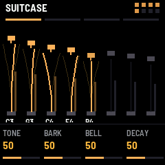

# FM-1 KEYS

FM-1 KEYS turns the M-VAVE FM-1 into a physically modelled keyboard. It has two engines and a chord engine:

- **KEYS**, a physically modelled Rhodes. It is the engine of [Frodhes](https://github.com/leonardoMirabal/frodhes)
  by Leonardo Mirabal: a hammer, the tine and tonebar fitted key by key to a 1977 Stage 73, and the magnetic pickup.
  Play softly and it's round and clean; dig in and it barks. There are four types: STAGE 77, SUITCASE, EARLY FELT and
  BELL DYNO.
- **PHYS**, an exciter played into a resonator. The exciters are pluck, strike, bow, blow and noise. The resonators
  are a string, a reed tube, or a struck body that morphs from wood to glass to metal to skin.
- **CHORDS**: one key plays the chord on that degree of the key and scale you choose. Chords have 3 to 6 notes and
  can be voiced close, open or voice-led, with a bass note under them and a strum if you want one.

This is a test build (0.1-dev). It runs in the browser emulator, and nothing here has been installed on an FM-1 yet.

---

## The screen

- **Header**: the patch name, with a dot when it has unsaved changes, and the chord you're playing. On the right,
  eight squares for the eight voices, lit while they sound. The four bars under them show the page you're on.
- **Middle**: the sound, drawn as it plays. On KEYS you see a tine for each voice, swinging as loud as it rings, and
  its pickup glowing. On a string or tube you see the actual wave travelling in the delay line, and where it's
  plucked, struck, bowed or blown. A struck body shows its shape wobbling in its modes, and a spectrum of those modes.
  The CHORD page shows the chord's name, its numeral in the key, and the notes on a keyboard. The FX page shows the
  level and the reverb's tail.
- **Footer**: the four controls of the page, on KNOB1 to KNOB4.

## Controls

| Control | What it does |
|---|---|
| SELECT | turns through the pages: SOUND, TONE, CHORD, FX |
| HOME / EDIT / ARP / FX | jump to SOUND / TONE / CHORD / FX |
| ARP (on CHORD) | chords on or off |
| ALGORITHM | the model: STAGE 77, SUITCASE, EARLY FELT, BELL DYNO (the piano's types), then STRING, TUBE, MODAL |
| PRESETS | the 15 factory patches |
| KNOB1-4 | the four controls in the footer |
| OCT- / OCT+ | the keys' octave |
| PLAY | auditions the patch with a four-chord progression in its key |
| SAVE | saves the sound (lit when there are changes) |

### The pages

| Page | KEYS | PHYS |
|---|---|---|
| SOUND | TONE (where the tine sits at the pickup), BARK (how close the pickup is), BELL (the overtones of the attack), DECAY (50 is the real instrument's) | EXCITE (pluck, strike, bow, blow, noise), MATERIAL (string: stiffness; tube: the reed; body: wood, glass, metal, skin), BRIGHT, DECAY |
| TONE | TREMOLO (stereo), RATE, DRIVE (the amp), DAMPER (how fast notes stop; 50 is the real instrument's) | POSITION (where it's plucked, struck or bowed), PRESSURE (bow and breath), ATTACK, RELEASE |
| CHORD | KEY, SCALE (major, minor, dorian, phrygian, lydian, mixolydian, harmonic minor), NOTES (3 to 6), VOICING (close, open, voice-led, voice-led with a bass note) | same |
| FX | REVERB, ROOM, STRUM (the gap between a chord's notes), TONE | same |

## Patches

SUITCASE, STAGE BARK, BELL TINES, NEO SOUL (chords in D dorian), NYLON, KOTO, HARP (strummed chords), BOWED, REED,
AIR TUBE, MARIMBA, GLASS BOW, TEMPLE BELL, HAND DRUM, BREATH PAD.

## MIDI

Notes come in on any channel, over USB and the TRS input. The sustain pedal (CC64) holds notes, and CC123 lets them
all go. With chords on, every incoming note plays its chord, so a MIDI keyboard or a sequencer plays chords too.

## Licence

FM-1 KEYS is free software under the GNU General Public License, version 3 only. The electric piano is Frodhes's
Rhodes engine by Leonardo Mirabal (GPL-3.0-only); the platform is fm1-base by Charles Vestal (MPL-2.0) on felucca-bsp
by Hügelton Instruments.
